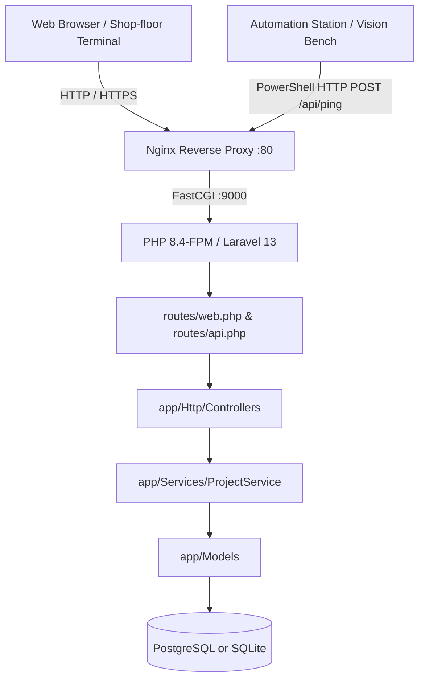

# Bitmap Project Tracker Blueprint


**Bitmap Project Tracker** is a production-grade industrial automation and hardware deployment project tracking application. Built with high performance, resilience, and offline-first capabilities in mind, it provides full lifecycle management across hardware procurement, panel assembly, PLC/vision software engineering, factory acceptance testing (FAT), and onsite commissioning.

---

## System Overview

Bitmap Project Tracker operates as a self-contained, offline-resilient operations workspace. The architecture cleanly separates presentation (Blade templates styled with Tailwind CSS v4 and standalone Chart.js visualization), business domain logic (hierarchical progress calculation and duration weighting in `ProjectService`), and persistence (relational Eloquent models backed by PostgreSQL or zero-config SQLite). In addition, it integrates plant-floor hardware telemetry scripts and containerized deployment blueprints.



---

## Local Interface & Invariants

The root directory contains root build configurations, container orchestration, and CLI entrypoints:

- `artisan`: Standard Laravel CLI command runner for migrations, seeders, route/config caches, and automated test execution.
- `vite.config.js`: Vite 8 asset pipeline bundle configuration linking `resources/css/app.css` and `resources/js/app.js`.
- `Dockerfile`: Multi-stage production container build provisioning Alpine Linux, PHP 8.4-FPM, Nginx, and Supervisord.
- `docker-compose.yml` & `docker-compose.dev.yml`: Container cluster compositions defining port bindings (8088 -> 80), volume mounts (`storage:/var/www/html/storage`), and environment overrides.
- `composer.json`: PHP dependency definitions, autoload mappings (`App\\` -> `app/`), and command shortcuts (`composer run dev`, `composer test`).
- `package.json`: Node frontend toolchain and development server scripts.

---

## Subdirectories & System Boundaries

- app: [./app/README.md](./app/README.md) - Application backend subsystem containing HTTP controllers, domain models, calculation services, and providers.
- bootstrap: [./bootstrap/README.md](./bootstrap/README.md) - Laravel 13 application kernel initialization, routing maps, and `/up` health check.
- config: [./config/README.md](./config/README.md) - Runtime environment configuration profiles, database drivers, and plant telemetry mappings.
- database: [./database/README.md](./database/README.md) - Schema DDL migrations, relational foreign key constraints, and default sample project seeders.
- docker: [./docker/README.md](./docker/README.md) - Container entrypoint scripts, Nginx virtual host configurations, PHP-FPM pool sizing, and Supervisord process management.
- public: [./public/README.md](./public/README.md) - Document root hosting front controller `index.php`, offline web fonts, standalone charting libraries, and PowerShell telemetry scripts.
- resources: [./resources/README.md](./resources/README.md) - Presentation templates, Blade workspace tabs, interactive modal dialogs, and raw JavaScript entrypoints.
- routes: [./routes/README.md](./routes/README.md) - HTTP route definitions for web UI operations, telemetry API endpoints, and console commands.

---

## Global Invariants

- **Offline-First Resilience**: All application dependencies, including client web fonts (`public/fonts`) and visualization libraries (`public/js/chart.js`), are bundled locally to guarantee full functionality on isolated, air-gapped industrial plant networks without external CDN access.
- **Relational Integrity**: Foreign key cascading deletes (`cascadeOnDelete`) are enforced across all sub-entities (`phases`, `groups`, `team_users`, `tasks`, `comments`, `attachments`) referencing `projects.id`.
- **String Primary Identifiers**: Entities use string-based identifiers across all models to permit client-side UUID generation and conflict-free JSON import/export synchronization.
- **Automatic Project Seeding**: If the database contains zero projects upon launching the workspace, `ProjectService::getActiveProject()` automatically runs `DatabaseSeeder::run()` to prevent uninitialized state errors.
- **Duration-Weighted Hierarchical Rollup**: Subtask progress aggregates into parent task progress weighted by `max(1, duration_days)`, avoiding divide-by-zero errors on milestone markers.

---

## Global Side Effects

- **Persistence Layer**: Reads and writes project state to either PostgreSQL (`pgsql`) or local SQLite file (`database/database.sqlite`).
- **Binary File Storage**: Uploaded project documents and diagnostic logs are persisted under `storage/app/private/attachments`.
- **Telemetry Ingestion**: Industrial telemetry scripts communicate with endpoint `POST /api/ping` and modify local Windows task scheduler jobs on client automation PCs.

---

## System Verification

- Run: `php artisan test`

---

## Key Features

- **Executive & Engineering Dashboard**: Real-time project progress, phase milestones, priority task distribution, recent attachments, and activity history.
- **Hierarchical Task Tree**: Structured task management categorized by phases, subtasks, checklists, priorities, and assigned engineers.
- **Interactive Gantt Timeline**: Visual schedule tracking with dependencies, milestone markers, critical path highlighting, and dynamic date adjustments.
- **Export & Reports Generator**: One-click printable reports formatted for executive summaries, phase delivery breakdowns, critical path analysis, and client status reports.
- **Telemetry & Industrial Forensics Integration**: Built-in support for hardware telemetry scripts, HWiNFO64 monitoring logs, and automation diagnostic packages.
- **Resilient Offline-Ready Architecture**: Self-contained SQLite persistence, self-hosted web fonts, and fallback offline CSS for air-gapped shop-floor workstations.

---

## Tech Stack

- **Backend**: Laravel 13 (PHP 8.3+)
- **Database**: PostgreSQL (`pgsql`) / SQLite (test suite & offline dev)
- **Frontend**: Laravel Blade, Tailwind CSS v4, Chart.js, Chart.js Trendline
- **Build System**: Vite 8 & Concurrently
- **Packaging**: Portable Windows IIS / Apache web server & Docker Compose support

---

## Getting Started

### Prerequisites

- PHP 8.3 or newer with `pdo_pgsql`, `pdo_sqlite`, and `mbstring` extensions
- Composer
- Node.js 18+ and npm

### Installation

```bash
# Clone the repository
git clone https://github.com/mirulaan/Bitmap_ProjectTracker.git
cd Bitmap_ProjectTracker

# Install PHP dependencies
composer install

# Environment setup
cp .env.example .env
php artisan key:generate

# Run database migrations and seeders
php artisan migrate --force
php artisan db:seed

# Install frontend dependencies and build assets
npm install
npm run build
```

### Running Locally

```bash
# Start development servers (Vite + Laravel server)
composer run dev
```

Visit `http://localhost:8628` in your browser.

---

## Testing

```bash
php artisan test
```

---

## Release Notes

### v1.0.0
- Migrated architecture to Laravel 13, SQLite, Blade, Tailwind CSS v4, and Vite.
- Implemented complete task hierarchy, interactive Gantt visualization, and reporting modules.
- Created standalone `VERSION` tracker and synchronized with production air-gapped deployment specs.
